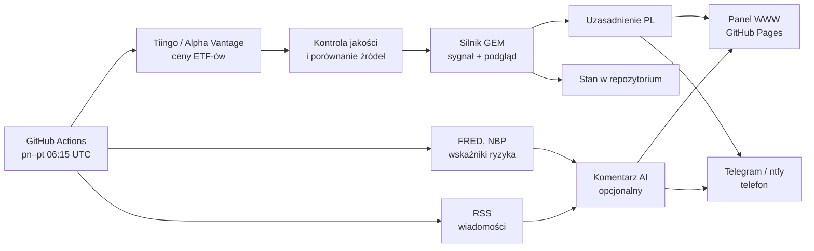

# Analiza strategii GEM (Global Equity Momentum) dla inwestora z Polski w XTB

Dokument techniczny narzędzia GEM Monitor. Stan wiedzy: listopad 2026.
Liczby z rozdziału 4 pochodzą z backtestu, który narzędzie odtwarza poleceniem `npm run research` (pełne tabele: [research/wyniki.md](research/wyniki.md)).

> **Zastrzeżenie.** To opracowanie opisuje opublikowaną, mechaniczną strategię i sposób jej realizacji. Nie jest poradą inwestycyjną. Autor nie jest licencjonowanym doradcą. Wyniki historyczne nie gwarantują przyszłych.

---

## 0. Najważniejsze wnioski

1. **GEM to strategia w pełni mechaniczna.** Raz w miesiącu porównuje 12-miesięczne stopy zwrotu i wybiera jedną z trzech pozycji: akcje USA, akcje poza USA albo obligacje. Nie ma w niej miejsca na prognozy ani interpretację wiadomości.
2. **Główną wartością jest ochrona przed długimi bessami, a nie wyższy zysk.** W backteście 1991–2026 GEM dał 11,7% rocznie wobec 11,1% dla akcji USA. Maksymalne obsunięcie wyniosło jednak −24%, a nie −50%. W latach 2000–2002 GEM zarobił +3,9%, gdy akcje USA straciły 45%. W kryzysie 2007–2009 stracił 7,7%, gdy akcje USA straciły 50%.
3. **Po publikacji książki (2014) wyniki wyraźnie osłabły.** W latach 2014–2026 GEM zarabiał 7,1% rocznie, akcje USA 13,4%, a portfel 60/40 8,6%. Zgadza się to z niezależnymi testami (rozdz. 4.6). Strategia nie chroni przed nagłymi krachami: w czasie krachu COVID straciła 20%. Nie chroni też, gdy obligacje tracą razem z akcjami: w 2022 r. straciła 18%.
4. **Polskie koszty mają duże znaczenie.** Przewalutowanie w XTB kosztuje 0,5% przy każdej wymianie walut. Podatek Belki (19%) płacisz przy każdej zmianie pozycji na koncie zwykłym. Razem obniżają wynik GEM z 11,7% do ok. 8,3% rocznie, czyli poniżej strategii „kup i trzymaj” po podatku (10,4%). Na IKE/IKZE podatek znika i wynik wynosi ok. 10,1%. **Najrozsądniej realizować GEM na IKE/IKZE.**
5. **ETF-y dostępne w XTB** (sprawdzone w ofercie xtb.com/pl 2 listopada 2026 r.):
   - akcje USA: **CSPX.UK**;
   - akcje poza USA: **EXUS.DE**;
   - obligacje USA: **IUAA.UK**;
   - bony skarbowe USA: **IB01.UK**;
   - rynki wschodzące (wariant rozszerzony): **EIMI.UK**.
6. **Wiadomości polityczne i geopolityczne są w narzędziu kontekstem, a nie przełącznikiem sygnału.** Pokazują, dlaczego rynki zachowują się tak, a nie inaczej, i jakie ryzyka obserwować. Gdyby mogły zmieniać sygnał, powstałaby nowa, nieprzetestowana strategia, a przewaga GEM wynika właśnie z dyscypliny (rozdz. 7).

---

## 1. Zasady strategii

Strategię opisał Gary Antonacci w książce *Dual Momentum Investing* (McGraw-Hill, 2014). Łączy ona dwa rodzaje momentum.

- **Momentum względne** (relative momentum): z kilku rynków wybierz ten, który rósł najmocniej.
- **Momentum absolutne** (absolute momentum, filtr trendu): inwestuj w akcje tylko wtedy, gdy rosną szybciej niż bezpieczne bony skarbowe. W przeciwnym razie przejdź do obligacji.

### Reguła (oryginał)

Ostatniego dnia sesyjnego każdego miesiąca:

1. Policz 12-miesięczną stopę zwrotu całkowitego (z dywidendami, w USD) dla:
   - S&P 500 (akcje USA);
   - MSCI ACWI ex USA (akcje całego świata poza USA);
   - bonów skarbowych USA.
2. **Filtr trendu:** jeśli stopa zwrotu S&P 500 jest **wyższa** niż stopa zwrotu bonów, rynek akcji jest w trendzie wzrostowym. Przejdź do kroku 3. W przeciwnym razie kup **obligacje zagregowane USA** (Bloomberg US Aggregate) i zakończ.
3. **Wybór rynku:** kup ten z dwóch rynków akcji, który ma wyższą 12-miesięczną stopę zwrotu.
4. Trzymaj pozycję przez cały kolejny miesiąc. Nie zmieniaj jej w trakcie miesiąca.

### Szczegół, który psuje wiele implementacji

W oryginale filtr trendu sprawdza się **na S&P 500, a nie na zwycięzcy** porównania. Jeśli akcje poza USA rosną, ale S&P 500 przegrywa z bonami, oryginalny GEM przechodzi do obligacji. Narzędzie robi to domyślnie (`absoluteRef: 'US'`). Wariant „zwycięzca kontra bony” jest dostępny w konfiguracji (`absoluteRef: 'WINNER'`), ale jest to już inna strategia.

---

## 2. Dlaczego to może działać: podstawy naukowe

- **Momentum względne** opisali Jegadeesh i Titman (1993): akcje, które rosły najmocniej przez 3–12 miesięcy, rosną ponadprzeciętnie również w kolejnych miesiącach. Asness, Moskowitz i Pedersen (2013) pokazali ten sam efekt dla indeksów krajowych, obligacji, walut i surowców.
- **Momentum absolutne**, czyli podążanie za trendem, opisali Moskowitz, Ooi i Pedersen (2012). Hurst, Ooi i Pedersen (2017) udokumentowali je na danych z ponad 100 lat. Aktywa, które rosły przez ostatni rok, częściej rosną dalej, a te, które spadały, częściej spadają.
- **Wyjaśnienia:** inwestorzy z opóźnieniem reagują na nowe informacje, potem ulegają owczemu pędowi, a długie trendy w gospodarce przekładają się na długie trendy na rynkach.
- **Dlaczego 12 miesięcy:** to okno jest najlepiej udokumentowane w badaniach i wymaga stosunkowo rzadkich transakcji.
- **Znane słabości:** momentum przeżywa gwałtowne załamania po końcu bessy, gdy najbardziej zdołowane rynki odbijają najmocniej (Daniel i Moskowitz, 2016; u nas widać to w 2009 r.). Filtr trendu z natury reaguje z opóźnieniem i nie nadąża za nagłymi krachami.

---

## 3. Specyfikacja algorytmu w narzędziu

Każdy punkt poniżej odpowiada konkretnemu fragmentowi kodu i jest objęty testami automatycznymi.

| Element | Jak to robi narzędzie | Dlaczego |
|---|---|---|
| Dane do sygnału | Dzienne ceny skorygowane o dywidendy (stopa zwrotu całkowitego) ETF-ów notowanych w USA, które śledzą te same indeksy: SPY (S&P 500), ACWX (MSCI ACWI ex USA), AGG (US Aggregate), BIL (bony 1–3M), a informacyjnie EFA i IEMG | Długa historia, dywidendy w cenie, wszystko w USD jak w oryginale. Ich odpowiedniki UCITS w XTB śledzą te same indeksy, więc ranking rynków jest taki sam. |
| Dostawcy danych | Tiingo (główny, dane dzienne) + Alpha Vantage (zapasowy i kontrolny, dane miesięczne) | Oficjalne API. Dwa niezależne źródła pozwalają wykryć błąd jednego z nich. |
| Koniec miesiąca | Ostatnie notowanie w miesiącu kalendarzowym. Musi być nie dalej niż 4 dni od ostatniego dnia roboczego miesiąca (tolerancja na święta). | Gdy brakuje ostatnich sesji, sygnał nie jest liczony na niepełnych danych. |
| Stopa zwrotu 12M | `cena(koniec M) / cena(koniec M−12) − 1` | Definicja z książki. |
| Reguła decyzyjna | Dokładnie jak w rozdziale 1. Filtr wymaga nadwyżki > 0, więc remis oznacza obligacje. Przy remisie dwóch rynków akcji zostajesz przy obecnej pozycji. | Brak niejednoznaczności i niepotrzebnych transakcji. |
| Moment decyzji | Po zamknięciu ostatniej sesji miesiąca. Uruchomienie w dni robocze o 06:15 UTC, przed otwarciem giełd w Europie. | Sygnał jest gotowy rano w pierwszy dzień sesyjny miesiąca, a zlecenie składasz tego samego dnia. |
| Podgląd w trakcie miesiąca | 12 miesięcy krocząco do najnowszego notowania. Gdy wynik różni się od sygnału, wysyłane jest ostrzeżenie. | Nie jest to sygnał handlowy. Pozwala przygotować się na możliwą zmianę. |
| Stabilność | Najmniejszy margines dzielący sygnał od zmiany. Poniżej 1 pp sygnał jest oznaczany jako „na granicy”. | Przy małym marginesie nawet drobny błąd danych mógłby odwrócić decyzję. |
| Kontrola jakości | Brakujące lub nieaktualne dane, ruchy większe niż 25% w ciągu dnia, luki w notowaniach i rozbieżność między źródłami (> 0,75 pp lub inna decyzja) wywołują ostrzeżenie albo blokadę sygnału oraz powiadomienie o błędzie. | Lepiej nie wysłać sygnału, niż wysłać błędny. |
| Powiadomienia | Sygnał miesięczny przychodzi dokładnie raz. Zmiana podglądu wywołuje jedno ostrzeżenie, a w poniedziałek przychodzi podsumowanie. Błąd zgłaszany jest najwyżej raz dziennie. Stan zapisywany jest dopiero po udanej wysyłce. | Brak duplikatów i brak zgubionych sygnałów. |

**Testy:** 46 testów automatycznych (`npm test`) sprawdza:
- wszystkie gałęzie reguły i remisy;
- bufor i obsługę wariantów;
- granice miesięcy, lata przestępne i weekendy;
- niekompletne i nieaktualne dane;
- porównanie dwóch źródeł danych;
- brak zaglądania w przyszłość w backteście;
- poprawność metryk, kosztów i podatku;
- parsery RSS, ZIP, FRED i plików Frencha;
- cały cykl uruchomienia z powiadomieniami i obsługą błędów.

---

## 4. Wyniki historyczne

### 4.1 Metoda

- **Dane:** Ken French Data Library: miesięczne stopy zwrotu całkowitego w USD dla rynku akcji USA, rynków rozwiniętych bez USA i rynków wschodzących, a także 1-miesięczne bony skarbowe. FRED: rentowności obligacji 5- i 10-letnich, z których liczone są stopy zwrotu obligacji.
- **Okres:** 08.1991–09.2026, czyli 35 lat. Obejmuje bańkę internetową, kryzys 2008, krach COVID i bessę 2022.
- **Przybliżenia:**
  - „Akcje poza USA” to ważona kapitalizacją mieszanka rynków rozwiniętych i wschodzących, czyli przybliżenie MSCI ACWI ex USA.
  - „Obligacje” to po połowie syntetyczne obligacje skarbowe 5- i 10-letnie. Ich duracja (ok. 6) jest zbliżona do indeksu Aggregate. W 2022 r. dały −12% wobec −13% dla indeksu. W 2008 r. były lepsze od indeksu, który zawiera obligacje korporacyjne.
- **Bez zaglądania w przyszłość:** decyzja zapada na danych do końca miesiąca M, a pozycja jest trzymana w miesiącu M+1.

### 4.2 Cały okres (1991–2026, bez kosztów)

| Strategia | Średnio rocznie | Zmienność | Sharpe | Maks. obsunięcie | Najgorsze 12 mies. | Zmiany pozycji na rok |
|---|---:|---:|---:|---:|---:|---:|
| **GEM klasyczny** | **11,7%** | 13,0% | 0,73 | **−24,4%** | −18,5% | 1,4 |
| GEM + wybór obligacje/bony | 11,7% | 12,9% | 0,73 | −24,6% | −15,9% | 1,5 |
| GEM rozszerzony (USA / rozwinięte / wschodzące) | 13,6% | 14,9% | 0,77 | −25,6% | −19,1% | 2,0 |
| Tylko filtr trendu (USA albo obligacje) | 11,1% | 12,3% | 0,71 | −24,3% | −18,5% | 0,7 |
| Akcje USA – kup i trzymaj | 11,1% | 15,1% | 0,61 | −50,3% | −42,6% | – |
| Akcje poza USA – kup i trzymaj | 7,1% | 16,0% | 0,36 | −57,0% | −51,2% | – |
| 60/40 akcje USA / obligacje | 8,7% | 9,1% | 0,69 | −29,2% | −25,6% | – |

GEM spędził 52% czasu w akcjach USA, 27% w akcjach poza USA i 21% w obligacjach. Przez 35 lat zmienił pozycję 50 razy.

### 4.3 Przed i po publikacji strategii

| Strategia | 1991–2013 | 2014–2026 |
|---|---:|---:|
| GEM klasyczny | 14,4% | 7,1% |
| GEM + wybór obligacje/bony | 14,2% | 7,6% |
| GEM z buforem 2 pp | 13,9% | 7,8% |
| Akcje USA – kup i trzymaj | 9,8% | 13,4% |
| 60/40 | 8,7% | 8,6% |

Przewaga GEM pochodzi prawie w całości z okresu przed publikacją. Po 2014 r. rynek USA rósł niemal bez przerwy, a strategia płaciła za fałszywe sygnały (przykłady w rozdz. 6).

### 4.4 Kryzysy (skumulowana stopa zwrotu w oknie)

| Okres | GEM | GEM + bony | Akcje USA | 60/40 |
|---|---:|---:|---:|---:|
| Bańka internetowa 09.2000–09.2002 | +3,9% | +1,5% | −45,0% | −21,3% |
| Kryzys finansowy 11.2007–02.2009 | −7,7% | −7,7% | −50,3% | −29,2% |
| Krach COVID 02–03.2020 | −20,2% | −20,2% | −20,2% | −10,0% |
| Bessa 2022 | −18,1% | **−13,2%** | −19,9% | −16,8% |
| Odbicie 03–12.2009 | +4,2% | +4,2% | +55,7% | +29,5% |

Wnioski:
- GEM świetnie chroni przed **powolnymi, długimi** bessami.
- Nie chroni przed **nagłym** krachem: miesięczny rytm decyzji jest za wolny.
- Gubi część **odbicia** po bessie.
- W 2022 r. obligacje nie były bezpieczną przystanią. Wariant „lepsze z obligacji i bonów” ograniczył stratę z −18,1% do −13,2%.

### 4.5 Wrażliwość na długość okna (GEM klasyczny)

| Okno | Cały okres | Maks. obsunięcie | Przed 2014 | Po 2014 | Zmiany na rok |
|---|---:|---:|---:|---:|---:|
| 3 mies. | 12,9% | −21,5% | 15,7% | 8,0% | 4,0 |
| 6 mies. | 10,7% | −27,6% | 14,1% | 5,0% | 2,6 |
| 9 mies. | 11,3% | −23,9% | 13,6% | 7,5% | 1,9 |
| 12 mies. | 11,7% | −24,4% | 14,4% | 7,1% | 1,4 |

Wyniki nie układają się monotonicznie, co oznacza, że ich różnice to w dużej mierze szum. Nie wybieraj okna na podstawie backtestu. 12 miesięcy ma najlepsze uzasadnienie w badaniach i najmniej transakcji, a każda transakcja w Polsce kosztuje.

### 4.6 Niezależne badania

- **Antonacci (2014)** w książce podaje dla lat 1974–2013 ok. 17,4% rocznie przy maksymalnym obsunięciu ok. 23% (S&P 500: ok. 12,3% i ok. 51%). To wyniki z okresu przed publikacją.
- **Quant4Free** (2008–2026, ETF-y SPY/VEU/AGG/BIL): GEM 9,1% rocznie przy obsunięciu −20%, SPY 11,6% przy −42%. Po 2014 r.: GEM 8,4%, SPY 13,6%, a 60/40 9,1%.
- **QuanterLab** (2008–2026, 18 jednorocznych okien poza próbą): GEM 9,3% (obsunięcie −33,7%), sam filtr trendu 10,7%, SPY 10,2% (obsunięcie −47,9%). Wniosek: obsunięcia ogranicza filtr trendu, a wybór między USA a resztą świata w tym okresie kosztował 1,4–3,2 pp rocznie.

Nasz backtest jest spójny z tymi wynikami. Tę samą strategię testowano niezależnie na różnych danych i wnioski są zgodne.

### 4.7 Co z tego wynika

GEM jest przede wszystkim **sposobem na ograniczenie katastrofalnych strat**, a nie maszyną do pobijania rynku. Ceną jest:
- długie okresy gorszych wyników niż „kup i trzymaj”: w latach 2019–2020 GEM zarobił +11% i +4%, a akcje USA +31% i +24%;
- seria fałszywych sygnałów w niespokojnych latach.

Strategia ma sens dla kogoś, kto boi się spadku o połowę bardziej niż słabszego wyniku w latach hossy i wytrwa przy regułach przez dekadę.

---

## 5. Implementacja w XTB

### 5.1 Instrumenty

Wszystkie instrumenty sprawdzono w ofercie na xtb.com/pl 2 listopada 2026 r., a 7 listopada 2026 r. porównano je ze wszystkimi alternatywami z tabeli specyfikacji instrumentów XTB (OMI, obowiązuje od 5.10.2026).

| Rola w GEM | Indeks | Ticker XTB | ETF | ISIN | Rynek, waluta | TER |
|---|---|---|---|---|---|---:|
| Akcje USA | S&P 500 | **CSPX.UK** | iShares Core S&P 500 UCITS ETF (Acc) | IE00B5BMR087 | LSE, USD | 0,07% |
| Akcje poza USA | MSCI World ex USA | **EXUS.DE** | Xtrackers MSCI World ex USA UCITS ETF 1C | IE0006WW1TQ4 | Xetra, EUR | 0,15% |
| Obligacje (bezpieczna przystań) | Bloomberg US Aggregate | **IUAA.UK** | iShares US Aggregate Bond UCITS ETF (Acc) | IE00BYXYYM63 | LSE, USD | 0,25% |
| Bony skarbowe (wariant obligacje/bony) | US Treasury 0–1Y | **IB01.UK** | iShares $ Treasury Bond 0-1yr UCITS ETF (Acc) | IE00BGSF1X88 | LSE, USD | 0,07% |
| Rynki wschodzące (wariant rozszerzony) | MSCI EM IMI | **EIMI.UK** | iShares Core MSCI EM IMI UCITS ETF (Acc) | IE00BKM4GZ66 | LSE, USD | 0,18% |

Alternatywy dostępne w XTB:
- Obligacje 7–10-letnie: CBU0.UK (IE00B3VWN518).
- Akcje poza USA w innych walutach: XMWX.UK (GBP), IXUA.DE i WEXE.DE (EUR).

TER pochodzi od emitentów. Przed pierwszym zakupem sprawdź dokument KID.

#### Dlaczego akurat te fundusze

Sygnał liczę na amerykańskich ETF-ach (SPY, ACWX, AGG, BIL), bo mają długą, codzienną historię z dywidendami. Kupić ich w XTB nie można, więc dla każdej roli wybrałem fundusz UCITS według kryteriów, w tej kolejności:

1. **Ten sam indeks co sygnał.** Wtedy kupujesz dokładnie to, co strategia zmierzyła, a różnica wyników to tylko koszty.
2. **UCITS z dokumentem KID.** ETF-y z USA są dla klientów detalicznych z UE niedostępne (brak KID).
3. **Fundusz irlandzki.** Umowa USA–Irlandia obniża podatek u źródła od dywidend z USA do 15% (fundusze z innych krajów płacą zwykle 30%). Inwestor spoza USA nie podlega też amerykańskiemu podatkowi spadkowemu.
4. **Akumulujący.** Dywidendy zostają w funduszu, tak jak w stopie zwrotu całkowitego, na której liczony jest sygnał. Na koncie zwykłym nie ma corocznego podatku od wypłat, a na IKE/IKZE nie trzeba reinwestować gotówki.
5. **Niski koszt i duża płynność.** Spośród zgodnych funduszy w XTB wybrałem najtańsze z największymi obrotami, czyli z najwęższym spreadem.
6. **Replikacja fizyczna.** Fundusz trzyma prawdziwe akcje i obligacje, bez ryzyka kontrahenta swapu.
7. **Notowanie w walucie funduszu (USD)**, gdy to możliwe. Na subkoncie USD nie ma wtedy żadnego przewalutowania. Na IKE/IKZE (tylko PLN) każda linia niezłotowa kosztuje tak samo 0,5%, więc liczy się płynność. Doradca waluty w zakładce Sygnał podpowiada najtańszy wariant dla Twojego rachunku.

Ocena każdej roli na tle wszystkich alternatyw w XTB:

| Rola | Wybór | Zgodność z sygnałem | Alternatywy w XTB i dlaczego nie |
|---|---|---|---|
| Akcje USA | CSPX.UK | ✅ ten sam indeks (S&P 500), najniższy TER w grupie, największy ETF UCITS na S&P 500 | SXR8.DE – ten sam fundusz w EUR (dobry na koncie z EUR). VUAA.DE (Vanguard, TER 0,07%) – równorzędny. SPXS.UK i I500 – replikacja syntetyczna (swap), historycznie ok. 0,2–0,3 pp rocznie lepsze dzięki braku podatku od dywidend z USA, ale z ryzykiem kontrahenta (ograniczonym przepisami UCITS). IUSA, SPY5 – dystrybuujące. ETFBSPXPL.PL – w PLN z zabezpieczeniem walutowym, bez przewalutowania na IKE, ale to inny wynik niż sygnał i wyższe koszty. |
| Akcje poza USA | EXUS.DE | ⚠️ kompromis: sygnał liczony na MSCI ACWI ex USA, a fundusz obejmuje tylko rynki rozwinięte (World ex USA, ok. 72% indeksu) | W XTB nie ma żadnego ETF-u UCITS na ACWI ex USA (sprawdzone w pełnej tabeli). IXUA.DE (iShares) – ten sam indeks co EXUS, mniejsze obroty. EXU1.DE – dystrybuujący. XMWX.UK – EXUS w GBP. Wierne odtworzenie: ok. 72% EXUS.DE + 28% EIMI.UK (rozdz. 5.2). |
| Obligacje | IUAA.UK | ✅ ten sam indeks co AGG (Bloomberg US Aggregate), który był bezpieczną przystanią w oryginale Antonacciego | Jedyny akumulujący fundusz na ten indeks w USD. IUAG.UK – dystrybuujący. CBU0.UK (obligacje skarbowe 7–10 lat, TER 0,07%) – tańszy, ale to inny indeks: dłuższy czas trwania, więcej zyskuje przy spadku stóp i więcej traci przy wzroście (2022). AGGU.UK – obligacje globalne, inna ekspozycja. |
| Bony skarbowe | IB01.UK | ✅ bardzo bliski BIL: obligacje skarbowe USA do 1 roku (ok. 0,5 roku czasu trwania) zamiast bonów 1–3-miesięcznych; różnica w stopie zwrotu to ułamki punktu | U03A.UK (0–3 miesiące) – jeszcze bliżej BIL, ale znacznie mniejsze obroty. PR1T/PR1H (Amundi), T1EU/TRD1 (Invesco), BBLL.DE (JPM) – równorzędne, notowane w EUR. |
| Rynki wschodzące (wariant rozszerzony) | EIMI.UK | ✅ ten sam indeks co IEMG (MSCI EM IMI), największy ETF UCITS na rynki wschodzące | IS3N.DE i EMIM.UK – ten sam fundusz w EUR i GBP. VFEA.DE (Vanguard FTSE EM) – inny dostawca indeksu (bez Korei Południowej w rynkach wschodzących). |

Wniosek: cztery z pięciu ról mają w XTB fundusz na dokładnie ten sam indeks, na którym liczony jest sygnał. Jedynym realnym kompromisem są akcje poza USA (brak rynków wschodzących w EXUS.DE). Jeśli chcesz pełnej zgodności, kupuj w tej roli ok. 72% EXUS.DE i 28% EIMI.UK albo wybierz wariant rozszerzony. Z punktu widzenia kosztów warto rozważyć jeszcze tylko syntetyczny fundusz na S&P 500 (SPXS.UK) – to decyzja między ok. 0,2–0,3 pp rocznie a ryzykiem kontrahenta.

### 5.2 Problem akcji poza USA

W XTB nie ma ETF-u UCITS na pełny indeks MSCI ACWI ex USA. EXUS.DE obejmuje rynki rozwinięte bez USA, czyli ok. 72% tego indeksu, bez rynków wschodzących. Masz trzy możliwości:

- **(a) Domyślnie:** sygnał liczony na ACWI ex USA, zakup EXUS.DE. Wierne co do logiki, a różnica w stopie zwrotu jest zwykle niewielka.
- **(b) Odtworzenie indeksu:** ok. 72% EXUS.DE + 28% EIMI.UK. Wiernie odtwarza indeks, ale wymaga dwóch transakcji.
- **(c) Wariant „rozszerzony”:** rynki rozwinięte i wschodzące jako osobne kandydaci. W backteście wynik był wyższy w całym okresie (13,6%) dzięki boomowi rynków wschodzących w latach 2003–2007. Po 2014 r. był taki sam jak w wariancie klasycznym (7,1%), przy większej liczbie transakcji.

### 5.3 Koszty w XTB

- **Prowizja:** 0% do 100 000 EUR obrotu miesięcznie, powyżej 0,2% (min. 10 EUR).
- **Przewalutowanie:** 0,5%, jeśli waluta instrumentu różni się od waluty rachunku.
- **Spread rynkowy:** dla tych ETF-ów zwykle od kilku do kilkunastu setnych procenta. Najwęższy jest w godzinach, gdy działa też giełda w USA.

Na rachunku w PLN każda zmiana pozycji oznacza dwie wymiany walut (sprzedaż USD→PLN i zakup PLN→USD), czyli ok. 1% kosztu.

### 5.4 Konto, waluta i podatek: skutki w liczbach (1991–2026)

| Scenariusz | GEM rocznie | GEM po likwidacji i podatku | Akcje USA (kup i trzymaj) po podatku |
|---|---:|---:|---:|
| Bez kosztów (teoria) | 11,7% | 11,7% | 11,1% |
| **IKE/IKZE w PLN** (FX 1% przy zmianie, bez podatku) | **10,1%** | **10,1%** | 11,1% |
| Konto zwykłe w PLN (FX 1% + Belka 19% przy każdej zmianie) | 8,4% | 8,3% | 10,4% |
| Konto zwykłe z subkontem USD (FX tylko przy ETF w EUR + Belka) | 9,5% | 9,4% | 10,4% |

Wnioski praktyczne:

1. **IKE/IKZE to najlepsze miejsce na GEM.** Zmiana pozycji nie wywołuje podatku, a strategia zmienia pozycję średnio 1,4 razy w roku. Sprawdź aktualny roczny limit wpłat na IKE/IKZE.
2. Na koncie zwykłym podatek płacony przy każdej zmianie zjada procent składany. Po kosztach GEM przegrywa wtedy z „kup i trzymaj”, ale nadal ma dwa razy mniejsze obsunięcia.
3. **Subkonto USD** (konto zwykłe) eliminuje przewalutowanie przy zmianach między ETF-ami w USD, czyli CSPX.UK, IUAA.UK i IB01.UK. EXUS.DE jest w EUR, więc wymaga wymiany.
4. Bufor 2 pp ogranicza liczbę zmian z 1,4 do 1,1 na rok, co przy kosztach FX ma realną wartość (rozdz. 8).
5. Możliwy kierunek na przyszłość: ETF-y w PLN z GPW (np. serie Beta ETF) pozwalają uniknąć przewalutowania na IKE. Śledzą jednak inne lub zabezpieczone walutowo indeksy, więc wymagałyby osobnego mapowania i weryfikacji. Narzędzie tego nie robi.

Pełna strategia podatkowa, w tym konto OKI od 2027 r., kolejność kont i porównanie brokerów na IKE/IKZE: [PODATKI_STRATEGIA.md](PODATKI_STRATEGIA.md).

### 5.5 Waluta dla inwestora z PLN

Sygnał jest liczony w USD, tak jak w oryginale. To jest poprawne: ranking rynków w USD nie zależy od kursu złotego, a filtr porównuje akcje w USD z bonami w USD. Twój wynik w złotych zależy jednak dodatkowo od kursu USD/PLN (lub EUR/PLN). Panel pokazuje 12-miesięczną zmianę kursu z NBP. Mocny złoty obniża wynik w PLN niezależnie od strategii.

### 5.6 Wykonanie zlecenia

- Pierwsza sesja miesiąca, w godzinach notowań LSE lub Xetra w XTB (ok. 9:00–17:30 czasu polskiego).
- Zlecenie z limitem ceny, najlepiej nie w pierwszych minutach sesji, gdy spready są szersze.
- Najpierw sprzedaż starej pozycji, potem zakup nowej za całość środków.
- Przed transakcją sprawdź, czy ticker nadal jest w ofercie XTB. Mapowanie zmienisz w `config/gem.config.js`.

---

## 6. Ryzyka i słabe strony (oraz jak narzędzie je adresuje)

| Ryzyko | Przykład z historii | Co robi narzędzie |
|---|---|---|
| Fałszywe sygnały (whipsaw) | 2015–2016, 2018–2019; w 2023 r. pozycja zmieniała się między USA a resztą świata niemal co miesiąc | Pokazuje stabilność sygnału i flagę „na granicy”. Opcjonalny bufor ogranicza zmiany. |
| Nagły krach | COVID 2020: −20% | Panel ryzyka (VIX, spready) i podgląd w trakcie miesiąca. Oryginalnych reguł nie zmienia. |
| Obligacje tracą razem z akcjami | 2022: −18% | Opcja `lepsze_z_obligacji_i_bonow` (w 2022 r.: −13%). |
| Długie okresy gorszych wyników | 2019–2020, 2023 | Historia sygnałów i backtest na panelu, by zachować realistyczne oczekiwania. |
| Zależność od dnia rebalansowania | Wyniki zmieniają się, gdy decyzja zapada np. 15. dnia miesiąca | Trzyma się oryginału (koniec miesiąca) i nie optymalizuje dnia. |
| Dopasowanie do historii | Okno 3 mies. i wariant 12-1 wyglądają lepiej w części okresów | Domyślnie obowiązuje oryginał. Warianty są opisane wraz z ryzykiem dopasowania. |
| Koncentracja | 100% w jednym ETF-ie | Rozważ GEM jako część portfela, a nie całość. |
| Błędy danych | Brak korekty o dywidendę lub split, opóźniony plik | Kontrola jakości, drugie źródło, blokada sygnału i powiadomienie o błędzie. |
| Zmiany w ofercie XTB | Usunięcie lub zmiana instrumentu | Konfiguracja w jednym pliku. Narzędzie przypomina o weryfikacji. |
| Porzucenie strategii | Rezygnacja po serii strat to najczęstsza przyczyna złych wyników | Uzasadnienie przy każdym sygnale i komentarz AI tłumaczą, co się dzieje. |

---

## 7. Wiadomości polityczne i geopolityczne: jaką rolę pełnią w narzędziu

### Dlaczego wiadomości nie zmieniają sygnału

1. **Ceny już uwzględniają publiczne informacje.** 12-miesięczne momentum jest podsumowaniem tego, jak rynek przetworzył wszystkie wiadomości: wojny, wybory, decyzje banków centralnych.
2. **Wyniki GEM dotyczą wyłącznie mechanicznego stosowania reguł.** Ręczne odstępstwa „bo w wiadomościach jest źle” tworzą nową strategię, której nikt nie przetestował. Badania nad przewidywaniem rynku na podstawie prognoz i nastrojów pokazują, że takie decyzje zwykle nie pomagają, a często szkodzą.
3. **Ryzyko geopolityczne jest mierzalne, ale trudno na nim zarabiać.** Indeks ryzyka geopolitycznego (Caldara i Iacoviello, 2022) rośnie przy spadkach rynków. Rynki często jednak szybko odrabiają te straty, a kto wyjdzie z rynku na fali strachu, zwykle wraca za późno.
4. **Wiadomości wzmacniają emocje.** Właśnie przed emocjami chroni dyscyplina GEM.

### Co narzędzie robi z wiadomościami

- **Panel ryzyka** (FRED, NBP): VIX, spread obligacji śmieciowych, krzywa rentowności, indeks niepewności polityki gospodarczej (EPU, Baker, Bloom i Davis), dolar, ropa, kurs USD/PLN. Każdy wskaźnik ma ocenę od „normy” do „kryzysu”.
- **Wiadomości** z kanałów RSS: BBC, MarketWatch, Al Jazeera, Fed, EBC, Bankier.pl i Google News. Narzędzie oznacza je regionami (USA, Europa, Azja, rynki wschodzące, Polska, Bliski Wschód, Rosja/Ukraina) i tematami (konflikty, sankcje i cła, banki centralne, wybory, energia, inflacja). Odrzuca wiadomości bez związku z rynkami.
- **Komentarz AI** (opcjonalny, Claude z wyszukiwaniem w sieci): krótko wyjaśnia, dlaczego wybrany rynek ma teraz najsilniejszy trend, jaki jest kontekst polityczny i geopolityczny oraz co mogłoby odwrócić trend. Model ma polecenie nie zmieniać sygnału i nie udzielać porad.

### Jak z tego korzystać

- Kontekst pomaga zrozumieć sygnał i spokojnie go wykonać.
- Jeśli sygnał jest „na granicy”, a ryzyko wysokie, przygotuj się na możliwą zmianę na koniec miesiąca. Nie działaj wcześniej.
- Jeśli chcesz dodatkowej ochrony, zdefiniuj ją **z góry** jako regułę (np. bezpieczna przystań obligacje/bony albo bufor). Sprawdź ją w backteście i dopiero wtedy włącz. Nigdy nie decyduj doraźnie.

---

## 8. Rekomendowana konfiguracja

| Ustawienie | Domyślnie | Kiedy zmienić |
|---|---|---|
| `variant` | `klasyczny` | Wariant `rozszerzony` daje osobny wybór rynków wschodzących. Oznacza więcej transakcji, a po 2014 r. nie dał lepszego wyniku. |
| `lookbackMonths` | 12 | Nie zmieniaj na podstawie backtestu (rozdz. 4.5). |
| `safeAssetRule` | `obligacje` (oryginał) | **`lepsze_z_obligacji_i_bonow` warto rozważyć.** To ta sama logika momentum absolutnego zastosowana do obligacji. W 2022 r. ograniczyła stratę o 5 pp, a w całym okresie dała ten sam wynik (11,7%). |
| `switchBufferPct` | 0 | 1–2 pp na IKE/IKZE w PLN, gdzie każda zmiana kosztuje ok. 1% na przewalutowaniu. W backteście 2 pp ograniczyły liczbę zmian o ok. 20%. |
| `skipMonths` | 0 | Wariant 12-1 wyglądał lepiej po 2014 r., ale gorzej przed 2014 r. To typowy objaw dopasowania do danych. |

Zasada nadrzędna: konfigurację wybierz raz, zapisz uzasadnienie i nie zmieniaj jej pod wpływem ostatnich wyników.

---

## 9. Architektura narzędzia

---

## 10. Źródła

- Antonacci, G. (2014). *Dual Momentum Investing: An Innovative Strategy for Higher Returns with Lower Risk*. McGraw-Hill.
- Jegadeesh, N., Titman, S. (1993). Returns to Buying Winners and Selling Losers. *Journal of Finance*, 48(1).
- Moskowitz, T., Ooi, Y. H., Pedersen, L. H. (2012). Time Series Momentum. *Journal of Financial Economics*, 104(2).
- Asness, C., Moskowitz, T., Pedersen, L. H. (2013). Value and Momentum Everywhere. *Journal of Finance*, 68(3).
- Hurst, B., Ooi, Y. H., Pedersen, L. H. (2017). A Century of Evidence on Trend-Following Investing. *Journal of Portfolio Management*, 44(1).
- Daniel, K., Moskowitz, T. (2016). Momentum Crashes. *Journal of Financial Economics*, 122(2).
- Caldara, D., Iacoviello, M. (2022). Measuring Geopolitical Risk. *American Economic Review*, 112(4).
- Baker, S., Bloom, N., Davis, S. (2016). Measuring Economic Policy Uncertainty. *Quarterly Journal of Economics*, 131(4).
- [Quant4Free – Dual Momentum out of sample](https://quant4free.com/analysis/dual-momentum/)
- [QuanterLab – Dual momentum GEM decomposed 2008–2026](https://quanterlab.com/research/antonacci-s-dual-momentum-taken-apart-gate-relative-leg-and-blends-across-four-l)
- [Bestfolio – Dual Momentum's 2022 Problem](https://bestfolio.app/blog/dual-momentum-2022-canary-models)
- [gem-zi-checkup – polska implementacja GEM z kosztami brokerów](https://github.com/kamilkaczmareksolutions/gem-zi-checkup)
- [Ken French Data Library](https://mba.tuck.dartmouth.edu/pages/faculty/ken.french/data_library.html), [FRED](https://fred.stlouisfed.org), [API NBP](https://api.nbp.pl)
- [XTB – konto i opłaty](https://www.xtb.com/pl/konto-i-oplaty), strony instrumentów, np. [CSPX.UK](https://www.xtb.com/pl/etf/ishares-core-s-p-500-ucits-acc-usd), [IUAA.UK](https://www.xtb.com/pl/etf/ishares-us-aggregate-bond-ucits-acc-usd), [EXUS.DE](https://www.xtb.com/pl/etf/xtrackers-msci-world-ex-usa-ucits-acc-eur), [IB01.UK](https://www.xtb.com/pl/etf/ishares-treasury-bond-0-1y-ucits-acc-usd), [EIMI.UK](https://www.xtb.com/pl/etf/ishares-core-msci-em-imi-ucits-acc-usd)
